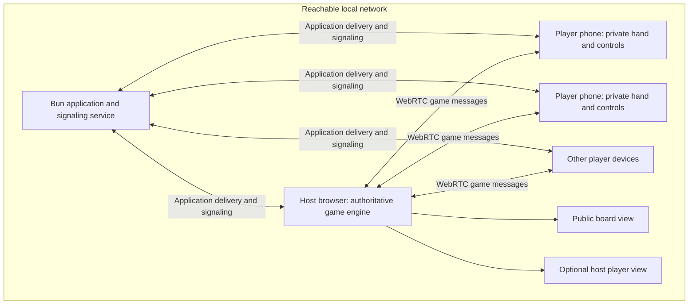
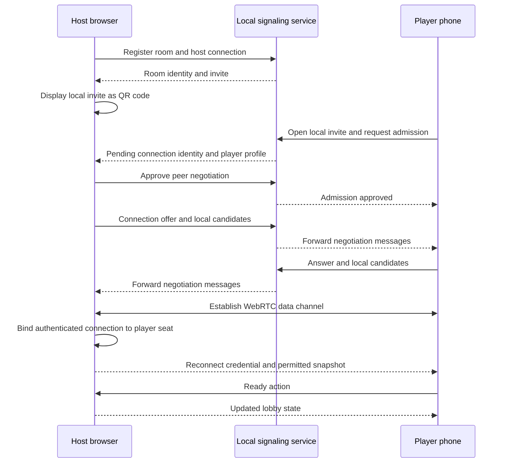

# Catania Architecture

Status: Proposed architecture for the same-Wi-Fi user flow. This document describes intended behavior, not an existing implementation or approval to start coding.

Related document: [Requirements and page flows](requirements.md).

## Architecture Summary

Use the existing Bun, React 19, TypeScript, and Tailwind foundation. A computer serves the application and a small local WebSocket signaling service. The room creator's browser owns the game state and rules. Each admitted player connects directly to that browser through a WebRTC data channel.

This is a host-and-peers topology, not an all-to-all mesh. A Board-Only Display host still runs the authoritative game engine; it simply renders only public information and does not occupy a player seat.

The diagram separates responsibilities, not additional deployed services. The public board and optional host hand are views inside the host application.

## Baseline And Scope

- `src/index.ts` currently serves the Bun application and template API endpoints.
- `src/App.tsx` and `src/index.css` currently contain the starter interface.
- The current dependency set includes React 19 and Tailwind; no multiplayer transport or game engine is implemented.
- Preserve this foundation unless implementation reveals a concrete limitation. Do not introduce a separate framework, database, or cloud service merely for the design.
- Choose additional packages only when implementing an approved requirement, such as local QR rendering or test tooling.
- Use TypeScript `type` declarations, full descriptive names, and the repository's preference for `ts-pattern@5` where exhaustive state handling benefits from it.

## Responsibilities

| Component | Owns | Does not own |
| --- | --- | --- |
| Bun application service | Local application delivery, assets, and WebSocket upgrades. | Game rules, turns, private hands, or authoritative board state. |
| Signaling service | Ephemeral room directory, host binding, connection identities, and delivery of peer negotiation messages. | Gameplay transport, deck generation, resource accounting, or public/private game projections. |
| Host session | Admission, seat bindings, organizer permission, turn execution, randomness, complete game state, and reconnection authorization. | A promise of secrecy from the host computer's operator. |
| Rules engine | Legal actions, phase transitions, resource changes, board graph rules, awards, and victory checks. | Rendering, socket management, or browser lifecycle. |
| State projection | Builds a public view and each player's permitted private view from authoritative state. | Network delivery or independent rule changes. |
| Player connection | Sends player intent, receives validated results and authorized snapshots, and restores an existing seat. | Authoritative dice, costs, placement decisions, or state mutation. |
| React interface | Renders the approved flow, previews choices, displays validation failures, and handles touch/keyboard interaction. | Trusting a hidden button as sufficient authorization. |

These are logical boundaries. Keep the implementation small; they do not require a class, service, or abstraction layer for every row.

## Local Deployment

1. Run the installed Bun application on a computer connected to the intended local network.
2. Listen on a network-reachable interface, not loopback only. Use an explicit reachable address for invitations.
3. Open a host browser, create a room, and select Host & Play or Board-Only Display.
4. Generate the QR code locally from the application origin and a room-scoped invite.
5. Player phones join the same Wi-Fi, scan with their normal camera application, and load the local page.

The computer may show the board on its own screen or a connected TV. A generic TV browser is not an assumed compatibility target. A browser tab alone cannot start the Bun service on a phone.

The advertised address cannot be inferred safely from every request: a host opening `localhost`, multiple network adapters, or a virtual private network can produce an unusable invite. Validate the chosen local address and allow it to be supplied explicitly if automatic selection is ambiguous. A room code is resolved only by the service the browser has already reached.

### Transport Constraints

- Use WebRTC data channels for gameplay with no configured external connection-discovery or relay servers. Local host candidates are the intended connection path.
- Keep all application assets local. Do not call an online QR-generation endpoint or load remote fonts during play.
- Local HTTP and WebSocket deployment is a compatibility target to validate, not a blanket browser guarantee. Verify peer data channels, local-network permission prompts, and local address handling in supported mobile browsers early.
- Do not depend on browser camera capture, service workers, or other secure-context-only features for the basic join flow.
- If a supported browser requires a secure local origin, trusted local HTTPS and secure WebSockets will need an explicit setup decision before that browser is advertised as supported. Do not hide this behind a cloud tunnel or an unannounced relay.
- WebRTC encrypts its data channel, but plain local HTTP and signaling do not provide protection against hostile devices on the same network. Treat the intended network and host as trusted.
- Browser private-address masking and multicast hostname handling can affect local peer discovery. Verify actual devices rather than assuming a successful desktop-only test proves phone support.
- Report blocked connectivity; do not silently replace peer gameplay with a server-based game transport.

## Room And Connection Lifecycle

### Admission And Roles

- A room invite permits a join request, not an automatic seat, organizer permission, or access to private state.
- The signaling service binds negotiation messages to their actual socket identity and room. It must not let a client impersonate another peer or claim to be the registered host.
- Host approval is associated with the exact pending connection. Confirm player count and color availability atomically when admitting the seat.
- In Host & Play, the host has a local player seat and organizer permission. Local actions go through the same rules validation as remote actions.
- In Board-Only Display, the first host-approved player receives organizer permission explicitly. After setup, Start Game and rematch controls are available on that phone, while the host screen remains public.
- Do not assign organizer permission merely to whichever unauthenticated device opens the invite first.
- New seats are allowed only before the game begins. An already occupied seat requires a separate reconnect credential.

### Identifiers And Credentials

Use distinct room identity, invite, player identity, connection identity, and reconnect credential concepts. A display name or color is not an authentication credential.

Generate non-guessable invites and reconnect credentials using browser or server cryptographic randomness as appropriate. A human-readable room code remains a convenience for requesting admission, not a secret capable of reclaiming a seat.

Store the room-scoped reconnect credential in the player's browser context so it survives a page refresh. Do not put it in the shared QR code, public snapshots, activity messages, or logs. Do not persist complete hands or full game snapshots merely to support reconnect.

Only one active connection may control a seat. When a valid reconnect replaces an old connection, revoke the old binding before accepting further actions from it.

## Game State And Rules

### Authoritative State

The host keeps the board graph, pieces, resource bank, player inventories, development deck, development-card purchase timing, active turn, phase, trade offers, robber/discard obligations, awards, winner, and state version in memory.

Random board generation, turn order, dice, deck shuffle, and theft are resolved by the host. Keep randomness injectable for rule tests; production uses an appropriate cryptographic random source. Never distribute a secret seed or deck order that would reveal future draws.

Use a pure, testable rules boundary that takes current state and a validated action, with random outcomes supplied where needed, and returns the next state or a rejection. The interface may derive legal previews, but the authority always checks the submitted action again.

### Phases

Model setup order, pre-roll actions, production, required discards, robber movement, victim selection, normal turn actions, development-card choices, and finished-game state explicitly. Avoid independent flags that can allow incompatible actions simultaneously.

Connection pause is a session condition layered over the game phase. A reconnect must not reset a half-completed mandatory sequence or advance the turn.

### Public And Private Projections

Never broadcast the full authoritative state and hide fields only in the interface.

Public projections include the board, dice, current player, required public phase prompts, public scores, awards, aggregate card counts, and public activity. They exclude exact resource hands, unplayed development-card types, hidden points, deck order, and credentials.

Each player receives the public projection plus only their own private information and applicable prompts. Theft details are delivered only to the thief and victim. Final results reveal the victory-point breakdown, not an unrestricted dump of the authority state.

The board-only React view consumes a public projection even though the host process holds full state. Organizer permission grants room controls, not access to other hands.

## Gameplay Protocol

Prefer one reliable, ordered WebRTC data channel per player. The small room size does not need a peer mesh, multiple transport channels, or a distributed-consensus protocol.

| Message category | Direction | Purpose |
| --- | --- | --- |
| Player intent | Player to host | Request a move, readiness change, trade response, or authorized organizer action. |
| Action result | Host to requesting player | Accept or reject a request with an actionable reason and authoritative version. |
| State snapshot | Host to individual player | Deliver public state plus that player's private projection. |
| Public event | Host to participants | Describe a roll, placement, turn change, or other non-private event. Can be carried with a snapshot rather than requiring a separate event stream. |
| Recovery control | Reconnecting player and host | Authenticate the occupied seat and request a fresh snapshot. |

For this four-player scope, sending small, filtered snapshots after accepted actions is simpler than maintaining a complex patch protocol. Do not include unbounded history in every snapshot.

### Action Processing

1. Validate the message shape, size, current room/game identity, and active connection binding.
2. Derive the player from the connection, never from an untrusted claimed player identifier.
3. Check the action identifier for duplication. A retry returns its previous result rather than applying it again.
4. Validate permission, current phase, turn, relevant object identity, resources, and rule preconditions against the latest authority state.
5. Resolve random outcomes if needed and apply the entire accepted action atomically.
6. Increment the state version, record the action result, and send the appropriate projections.

Use a per-game identity in addition to a state version so delayed messages from a previous match cannot mutate a rematch. Retain duplicate-detection results for the active game and reset them with the game identity.

An expected version can detect stale previews, but do not reject every otherwise valid concurrent response merely because another response advanced the version. For example, multiple players can answer the same live trade offer or submit required discards. Validate the current offer or obligation and its remaining preconditions.

Serialize authoritative mutations so simultaneous trade responses, resource changes, or reconnections cannot spend a hand twice. A trade commits only after the proposer selects one valid accepting player and both inventories are rechecked.

Do not render a pending move as a completed authoritative move. Disable duplicate submission while pending and reconcile against the returned state.

## Recovery And Failure Handling

- Monitor connection health, stop accepting actions from disconnected bindings, and show a connection overlay on affected phones.
- Reserve disconnected seats and pause game progression until admitted players reconnect. Never auto-play their choices.
- Use the local signaling service to negotiate a replacement peer connection to the still-running host.
- Authenticate the reconnect credential before returning private information or granting control of the existing seat.
- Send a fresh filtered snapshot with the current game identity and version. The player replaces stale local state before enabling controls.
- Distinguish a dropped data channel or signaling socket from confirmed room termination. A network interruption alone is not evidence that the host tab closed.
- A brief signaling interruption need not invalidate established data channels, but new connections and reconnection negotiation require the service. Do not promise support for continuing after the service restarts and loses its room directory.
- A host refresh, host tab closure, explicit room end, or service restart ends the supported session. There is no migration, saved-state recovery, or elected replacement host in the first version.
- If a player permanently leaves during a match, retain the pause and allow the room to be ended. Do not invent a replacement-player or turn-skipping rule.

## Interface Structure

Follow the [page flows](requirements.md#page-flows) rather than inventing additional account, matchmaking, or settings screens.

Use shared board rendering for public display and player interaction, with role-appropriate projections and controls. A host player sees a private player interface; users choosing a public shared screen must select Board-Only Display instead.

The player's default view is Hand, with Board and Players navigation. Build, trade, development-card choices, discard, and robber actions use sheets or overlays that keep the game context visible. The board supports touch-friendly location selection, zoom, and panning on phones.

Keep visual state distinct from rule state: an unconfirmed selected edge, open sheet, or zoom level does not belong in authoritative game state. Accepted placement, resource transfer, and required phase choices do.

## Verification Strategy

| Layer | Planned verification |
| --- | --- |
| Rule engine | Deterministic unit tests for legal and illegal actions, graph rules, resource conservation, finite supply, turn phases, development cards, awards, and victory. |
| Protocol and projections | Tests for identity spoofing, unapproved connections, duplicate requests, stale offers, concurrent responses, rematch message isolation, and absence of private data from unauthorized projections. |
| Local signaling | Tests for room lifecycle, room isolation, peer binding, host-only admission decisions, negotiation delivery, and expired-room behavior. |
| Browser flows | Automated UI tests across separate browser contexts for both host modes, joining, readiness, setup, private hands, turn actions, recovery, results, and rematch. |
| Real devices | A local computer with physical phones, native-camera QR opening, same-Wi-Fi peer channels, internet disconnected, mobile background/resume, firewall failure, and privacy on the shared display. |
| Build and documentation | Type checking, production build, updated run instructions, and recorded browser/network limitations. |

Browser automation alone does not verify a phone can reach the local address or that the real Wi-Fi permits peer traffic. Record which checks ran and which remain unverified. No tests or implementation outcomes are claimed by this design document.

## Implementation Sequence

1. Obtain approval of the revised same-Wi-Fi scope and page flows.
2. Prove local app delivery, QR joining, and host-to-phone data channels on the intended browsers. Resolve any local-origin restrictions before building the complete interface.
3. Implement the rule engine with tests for the proposed base-game scope.
4. Integrate admission, identity, projections, action validation, and player reconnection.
5. Implement the approved responsive pages and board-only/private-player separation with automated UI tests.
6. Verify a complete game and failure cases on actual devices, then update the existing run documentation with the final local setup and manual checks.

## Deferred Decisions

- Final approval of the proposed 3-4 player base-game scope and device flows.
- Exact browser support based on the local-network prototype, including whether any browser needs trusted local HTTPS.
- Final library choices, module layout, application port, and deployment commands, to be selected during approved implementation rather than presented as existing functionality.

These decisions do not reopen the confirmed same-Wi-Fi-only requirement or authorize a cloud-based fallback.
