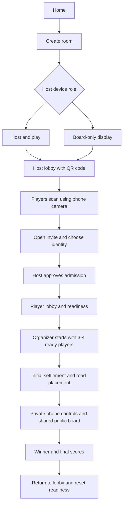

# Catania Requirements

Status: The local base game, including AI opponents and solo hand visibility, is approved and implemented. The same-Wi-Fi multiplayer product described below remains a future milestone, not an implemented capability.

Related document: [Architecture](architecture.md).

## Current Milestone

The approved first delivery is the full 3-4 player base game on one shared device,
styled with Tailwind CSS. It includes randomized boards and turn order, snake
setup, finite banks and piece supplies, production, building, domestic and
maritime trades, robber/discard sequences, development cards, awards, and a
10-point victory with results and rematch.

The table has three or four total seats and a selectable human count from one
to the seat count, defaulting to one. Local AI fills the remaining seats. Human
players enter distinct names. With one human, their hand opens automatically and
remains available during AI turns; no reveal or pass-device step is needed.
With multiple humans, the device is passed to the named human before revealing
their hand. Handoff screens remove private hand UI from the rendered page.
Computer hands cannot be opened through handoff or trade controls.

AI handles initial placement, turns, building, development cards, discards, and
robber/theft choices using its own hand and public information. Its basic local
strategy uses bank/port trades, accepts or declines exact human trade offers, and
quotes equal-count prices for resource requests when useful to its build plan;
it does not initiate player trades or use opponents' private hands to set prices.
The active player can request cards without specifying payment, or create an exact
offer. Human recipients use private handoffs to propose a price or accept/decline.
The active player compares responses as give/receive cards and confirms one exchange,
or withdraws the request/offer. Unaffordable prices show the exact missing quantities
and disable completion. Change offer preserves the requested cards and opens an exact
offer with payment limited to the player's hand. Canceling the edit leaves the current
trade intact; submitting replaces it and clears prior responses.
No cards move before confirmation; both inventories are rechecked
and completed exchanges must give and receive different resources. The browser
necessarily contains complete local state, so this is a
friendly display-privacy convention rather than a security boundary.

This milestone replaces neither the network requirements nor their verification
criteria. Rooms, QR codes, separate phone controllers, board-only host mode,
WebRTC, admission, and reconnection are not implemented or advertised as working.
The game is in memory only; refreshing or closing the tab loses it. The UI warns
before an intentional exit and asks the browser to warn on refresh during play.

Rule tests and desktop/mobile browser tests accompany the local implementation.
See the README for commands and the architecture document for verification
boundaries. Physical-phone network checks below apply to the future milestone.

## Purpose

Build a Catan-style browser board game for a group on the same Wi-Fi network. Players join by scanning a room QR code and use their own devices for private cards and game actions. A host device can act as a shared, board-only display without occupying a player seat.

## Decisions And Assumptions

### Confirmed Requirements

- Provide a Catan-style board game with peer-to-peer connections.
- Support same-Wi-Fi play rather than an internet multiplayer service.
- Let players scan a QR code to join from their own devices.
- Offer a device mode that displays the shared board without being a player.
- Prepare page-by-page user flows before coding.
- Document the architecture and requirements in `docs/`.

### Planned Multiplayer Version

The local base-game scope above is approved. The remaining device and network
details from the user-flow discussion are proposals, not separately approved
implementation requirements:

- Use Catania as the working name.
- Implement the standard 3-4 player base game with a 10-victory-point winning condition.
- Use a computer to run the local application and connection service.
- Provide Host & Play and Board-Only Display modes.
- Make the first host-approved player the organizer when the host is display-only.
- Require no accounts or application installation on player devices.
- Keep rooms and games in memory; support player reconnection but not host migration or saved-game recovery.
- Use original visual assets with a warm tabletop style, readable terrain, and distinct player pieces.

The local game-first scope above has been approved. Implementation of the
remaining multiplayer flows still requires its own approved scope.

## Device Roles

| Role | Responsibilities | Player seat |
| --- | --- | --- |
| Local service computer | Serves the application and introduces local browser peers. Normally also opens the host browser. | None merely for running the service. |
| Host browser | Creates the room, admits players, runs the authoritative rules and game state, and remains open throughout play. | Only in Host & Play mode. |
| Board-only host | Shows the lobby and public game board. Does not show a private hand or participate in turns. | None. |
| Organizer | Starts the game and initiates a rematch. In display mode, the first admitted player receives this role explicitly through host approval. | One. |
| Player device | Shows that player's private hand, public board, and permitted game actions. | One per admitted player. |

An organizer is not a replacement host. Assigning the organizer role does not move the authoritative game state to that phone.

## Network Requirements

- The local service and all participating devices must be reachable on the same local network. The intended setup is the same normal home Wi-Fi, or a computer wired to that Wi-Fi router.
- The QR code must contain a reachable local application address and room invite, not `localhost`, a loopback address, or a wildcard bind address.
- Scanning opens the room; it does not connect the phone to Wi-Fi. Show this instruction beside the QR code.
- Offer a copyable invite link and a room code as alternatives. A room code works after the player opens the correct local application address; it is not a way to discover a computer on the network.
- Do not require public signaling, public connection-discovery servers, internet relays, externally hosted fonts, or externally hosted game assets during play.
- Provide actionable failure messages for an unreachable service, blocked peer connection, missing room, full room, or denied admission. Do not claim to detect a specific network cause when it is unknown.
- Guest Wi-Fi, access-point isolation, operating-system local-network restrictions, and firewalls can prevent connections. Document these limitations.
- Internet access may be needed for initial dependency installation. Once installed and running locally, the intended game flow must work without internet access.
- Same-Wi-Fi is a deployment constraint, not proof that browsers share the same wireless network name. The application does not attempt to inspect or verify that name.

## Main Flow



## Page Flows

The following describes logical pages. Initial placement and results can reuse the game layout; connection recovery is an overlay, not a separate navigation destination.

| Page | Entry | Content and actions | Exit and important states |
| --- | --- | --- | --- |
| Home | Open the local application. | Explain private phone hands and the optional shared screen. Offer Create Game and Join Game. | Create Room or manual Join Game. If the service is unreachable, the browser may show its own error before the application loads. |
| Create Room | Select Create Game. | Choose Host & Play or Board-Only Display. A playing host chooses a name and available color. Show player count, rule summary, and host-tab lifetime warning. | Create the room and enter Host Lobby. Creation failure must not show a working invite. |
| Host Lobby | Room creation succeeds. | Show QR code, local address, invite link, room code, roster, pending admission requests, readiness, and connection status. Approve or reject requests and remove admitted players before play. | Start only when 3-4 players are admitted, connected, and ready. A playing host occupies one seat. A display-only host occupies none. |
| Join Game | Scan an invite with the phone's normal camera, follow a link, or enter a code on the local application. | Confirm the room, enter a name, choose an available color, and request admission. Explain that joining requires the same Wi-Fi. | Show connecting and waiting-for-approval states, then Player Lobby. Handle invalid invite, full room, rejected request, unavailable color, and game-already-started states. Existing players use reconnect instead of claiming new seats. |
| Player Lobby | Admission and peer connection succeed. | Show identity, roster, connection state, and Ready toggle. Allow identity changes before start; changing identity clears readiness. The organizer also sees Start Game. | Automatically advance when the host accepts Start Game. A lost connection removes the player from the ready-to-start condition. |
| Initial Placement | The organizer starts the game. | Display order and an explicit placement prompt. Only the active player can choose highlighted legal settlement and adjacent road positions on their own device. Other devices show whose turn it is. | Complete forward then reverse placement order, grant starting resources, and enter normal play. The shared display mirrors confirmed placements without action controls. |
| Player Game | Initial placement ends or an existing player reconnects. | Provide Hand, Board, and Players views. Show turn status, contextual actions, private prompts, connection state, and public activity. | Continue through turns until a valid win. Required choices appear in sheets or overlays rather than navigating away. |
| Board-Only Game | A display-only host starts initial placement or normal play. | Prioritize the landscape board, pieces, dice, active player, public scores, public card counts, awards, and public activity. Show connection/pause notices without private details. | Update live and transition to public Results. Do not show private hands, hidden points, or player action buttons. The lobby QR panel is no longer the primary screen. |
| Connection Recovery | A player transport disconnects, or a returning player opens the same room. | Preserve the current view, disable game actions, and show reconnection status. Attempt to restore the existing seat using the browser-held reconnect credential. | Replace stale state with a fresh authorized snapshot, then resume. An expired room or invalid credential gets an explicit error, not another player's seat. |
| Results | A player reaches the winning condition on their turn. | Show winner, final scores, and victory-point breakdown including revealed victory-point cards. Offer rematch readiness or Leave Room to players. | Organizer initiates a rematch into the lobby with readiness reset. A display-only host follows the room automatically. Host departure ends the room. |

## Player Device Experience

### Default Hand View

The phone is a private hand and a controller, not merely a remote score display.

```text
CATANIA                     Connected
Alex / Blue                 Your turn

[ Hand ]     [ Board ]     [ Players ]

YOUR RESOURCES
Wood     3       Brick    2
Wool     1       Grain    2
Ore      0

YOUR DEVELOPMENT CARDS
Knight           Victory Point

YOUR POINTS
3 public + 1 hidden = 4

Dice rolled: 8
You received 1 grain.

[ Build ]              [ Trade ]
[ Buy Development Card ]
[ End Turn ]
```

This example is after a roll. Before rolling, Roll Dice is the primary action. Development-card eligibility must still follow the rules, including permitted pre-roll use.

### Main Views

| View | Contents |
| --- | --- |
| Hand | Exact resource counts, development-card identities, private prompts, personal total points, and actions available in the current phase. |
| Board | An interactive, zoomable board showing public state. Supports placement and robber selection without requiring access to the shared screen. |
| Players | Public scores, resource-card counts, development-card counts, awards, current turn, and connection status. Never exposes another player's resource composition or unplayed development-card identities. |

### Action Flows

| Action | Flow and validation |
| --- | --- |
| Roll | Request a roll once for the active turn, unless a required action must first be resolved. The host generates the result and applies production or the robber sequence. |
| Build | Choose a piece, inspect the cost, select a highlighted legal location, and confirm. Validate turn, phase, resources, piece supply, and placement before changing state. |
| Player trade | Active player selects resources to give and receive and sends an offer. Other players accept or decline privately on their devices. The proposer selects an accepting player to complete exactly one exchange. Revalidate both hands at completion. Cancel stale offers when their phase or turn ends. |
| Bank or port trade | Choose an exchange, show the applicable ratio and resulting hand, and confirm. Validate ownership of the port, resources, and bank supply. |
| Buy development card | Display cost and confirm. Draw from the host-held deck and send the identity only to the buyer. |
| Play development card | Select an eligible card, explain its effect, collect required selections, and confirm. Respect timing, per-turn restrictions, and the newly purchased card restriction. |
| Cancel Knight | Before confirming its robber move, the active player may return the Knight to their hand and restore the played-Knight count, prior Largest Army ownership, development-card allowance, and previous turn phase. Clear any selected hex. Do not permit cancellation after the move, for a seven-triggered robber, or after an immediate Knight victory. Keep this action distinct from cancelling only a tile preview. |
| Discard after seven | Privately show the required discard count, select exact resources, and confirm. Do not advance the robber step until all required discards are resolved. |
| Move robber | Select a different legal tile and an eligible victim if one exists. Resolve a random theft; only the involved players learn the transferred resource identity. |
| End turn | Enable only after mandatory actions are complete. Clear unfinished offers and advance the active player. |
| Wait for turn | Inspect hand, board, costs, and public activity. Respond to eligible trade offers and mandatory prompts, but never perform another player's turn-only action. |

No optimistic action may spend resources or place a piece as if accepted before the host validates it. A pending selection can be previewed distinctly.

## Base Game Rules

The playable rules scope is the standard base game, not a board-only prototype or a simplified rule variant.

- Support 3-4 players and the standard 19-land-hex island, terrain distribution, number tokens, desert, robber, and nine ports. Generate a legal board with a valid number-token arrangement.
- Use the standard finite resource bank, development-card deck composition, and per-player piece limits.
- Randomize turn order and use forward/reverse setup placement. Enforce the settlement distance rule and grant starting resources from the second settlement.
- Implement two-dice production, settlements producing one resource, cities producing two, robber-blocked production, and base-game bank-shortage behavior.
- Implement standard road, settlement, city, and development-card costs. Apply network connectivity, placement, upgrade, and piece-return rules.
- Support domestic trading during the active player's turn and maritime trading at standard bank, generic-port, and resource-port ratios.
- On seven, require players with more than seven resource cards to discard half, rounded down, then move the robber and resolve eligible theft.
- Implement Knight, Road Building, Year of Plenty, Monopoly, and hidden victory-point cards with their standard timing and effect restrictions. Victory-point cards are not ordinary played action cards.
- Award Longest Road and Largest Army with their standard thresholds, two-point values, tie behavior, and transfer rules. Evaluate blocked roads, branches, and loops correctly.
- A player wins on their own turn when their total reaches at least 10 points, including hidden victory-point cards. Show only public points to others before victory.
- No game action can violate turn ownership, an unresolved mandatory phase, available resources, supply limits, or seat identity.

Any discovered rule ambiguity must be resolved against the base-game rules before implementation, not silently replaced with a simpler house rule.

## Privacy And Trust

| Information | Visibility |
| --- | --- |
| Terrain, tokens, roads, settlements, cities, robber, dice, active player, awards, and public points | All participants and the shared display. |
| Each player's total resource-card count and total development-card count | All participants and the shared display. |
| Exact resource composition, unplayed development-card identities, and hidden victory points | Owning player and the authoritative host only. |
| Randomly stolen resource identity | Thief, victim, and authoritative host only. |
| Complete deck order, credentials, and full authoritative state | Internal authority/connection handling only, never public snapshots or activity logs. |
| Final victory-point breakdown | All participants after the game ends. |

The host necessarily holds private game state in memory. Board-only means display privacy, not secrecy from the person controlling the host computer. This is a friendly local game, not a cheat-proof or hostile-network system.

## Recovery And Lifetime

- Require the local service and host browser to remain running throughout the room's lifetime. Warn before starting and before an intentional host exit.
- Keep a disconnected player's seat reserved. Pause progression while an admitted player is disconnected; do not skip turns, auto-discard, or replace them with a bot.
- A player may reconnect after a temporary network loss, phone backgrounding, or page refresh in the same browser context with a valid room-scoped credential.
- Reconnection restores the same player identity and a fresh permitted state. A room code or invite alone cannot reclaim an occupied seat.
- A reconnect attempt from a different browser or a cleared browser storage context is not guaranteed to recover the seat. Cross-device seat transfer is out of scope.
- A host refresh, host tab closure, or local service restart ends the supported room lifetime. Do not promise recovery from a stored game or another host.
- A transient transport failure is not proof that the host has closed. Show waiting/reconnecting until the room can be contacted or is confirmed unavailable.
- During play, no new player may replace a disconnected seat. If that player cannot return, the room must be ended rather than silently changing the rules.

## Usability Requirements

- Support portrait player phones and landscape shared displays without clipped controls or page-level horizontal overflow. A zoomable board can pan within its own area.
- Start the Turn controls panel with the active player's name and Your turn/Their turn, plus a high-contrast Setup/turn-number badge. Follow with the dice result, current-action card without a repeated turn-owner label, and persistent roll/end-turn buttons. Keep computer-activity announcements in the action description.
- Visually separate the desktop right sidebar into three detached panels: Bank; Your cards, including resources, development cards, and build/trade controls; and Turn controls, containing the dice result, current-action card, and roll/end-turn buttons. Use rounded borders, subtle shadows, and compact page-background gaps between the panels: 12 pixels on desktop and 8 pixels on phones. Scroll the cards panel independently while keeping the full-height board and turn controls stable.
- Keep local gameplay within the viewport without page scrolling. Keep board and dice regions stable so roll stages, computer notices, and previews do not shift the island. Dock the dice tray, turn-status card, and roll/end-turn controls at the bottom of the right-hand action sidebar on desktop, with the status card directly above the buttons. Keep both buttons visible in fixed positions and disable unavailable actions. Other sidebar content scrolls vertically without horizontal overflow. Keep the shared bank above the sidebar and let the board fill the full height beside both. On phones, keep the turn-status card and controls at the bottom of Hand and the dice summary above the bank across all game views. On short screens, hand/player panels and long dialogs may scroll internally; table reference information opens separately.
- Keep the revealed player's current resource quantities visible in discard and player-trade panels, including trade responses and confirmations, development-card purchases, and Year of Plenty or Monopoly resource choices. Omit hand summaries for Knight, Road Building, Victory Point, and theft confirmation. Use card quantity controls and one discard progress summary rather than repeating owned/selected/remaining captions for every resource; retain per-resource availability and remaining amounts in accessible descriptions. Bank exchanges show owned quantities on selection cards and preview the resulting quantities without a duplicate hand summary. Handoff selection shows human names and colors without detailed player cards; remove private summaries during handoff.
- Show readable per-resource hand quantities and a total, plus each player's public resource-card and development-card totals as compact icon-and-number badges with full labels in player details and accessible names. Never reveal opponents' card identities. Stack road, settlement, city, and development-card purchase controls vertically with distinct icons, labels, and costs. The development-card row shows one wool, one grain, and one ore; place a full-width trade button below the stack.
- Use large touch targets, readable resource labels, and selected-state indicators. Do not rely on color alone for player identity or valid positions.
- Show the revealed player's owned development cards as a vertical stack, with a distinct icon, name, and description below the title for each card. Hide the entire section when the player has no development cards. Omit "In your hand" and "New this turn" labels from the stack and development dialog. Keep duplicate cards separate; selecting a row opens that card in the development dialog without playing it. Preserve play restrictions and remove the stack during private handoff.
- Explain unavailable actions and required next steps. Require confirmation for board placement and resource transfers. Place board confirmation beside the selected intersection, road, or hex without resizing the map; keep it inside the visible map during zoom/pan. Support keyboard confirmation and Escape cancellation with focus restored to the selected target.
- Provide keyboard-operable controls and visible focus. Honor reduced-motion preferences.
- Show dice settling, matching number-token highlights rather than hex-border highlights, and private resource-gain feedback in sequence. Distinguish robber-blocked tokens from unblocked matches, and identify actual production separately. Keep a fixed-size roll summary available across phone views, explain sevens and blocked or unavailable production, and show immediate static results with reduced motion.
- Animate actual resource gains from setup, dice, trades, theft, and development cards in an on-screen collection tray and over stationary revealed hand cards, with gain badges. Keep collection feedback visible while the hand is off-screen, clear it on private handoff, and suppress motion without hiding receipt information when reduced motion is enabled.
- Keep private details off the shared display, including notifications and reconnect overlays.
- Do not require in-app camera access. The operating system's QR scanner opens the invite.

## Out Of Scope

- Internet matchmaking, remote play, public signaling, or internet relay infrastructure.
- Accounts, chat, spectators, additional independent board-display clients, network/replacement bots, expansions, and custom rules. Local AI opponents are included in the current milestone above.
- Automatic Wi-Fi setup, automatic host migration, persistent saved games, and recovery after host refresh or service restart.
- Protection against a malicious host or other hostile participants on the local network.

## Acceptance And Verification

| Area | Required evidence before declaring implementation complete |
| --- | --- |
| Local joining | A computer and three physical player devices on the same reachable Wi-Fi join through the displayed QR code. Repeat with internet access disconnected after setup. No runtime external assets or connection services are required. |
| Device roles | Verify a board-only host has zero player seats and no private/action UI, and Host & Play uses one seat with a private hand. |
| Lobby | Verify admission, unique color selection, readiness, organizer start permission, rejection of a fifth player, and rejection of new players after start. |
| Game rules | Automated tests cover setup, costs, placements, turn phases, production shortages, trades, robber/discard, every development-card effect, awards, and victory. Include illegal and out-of-turn actions. |
| Complete play | Separate browser sessions complete setup, turns, trading, building, special actions, and a valid win. Verify results and rematch reset. |
| Privacy | Inspect rendered views and actual peer payloads. Another player's private hand, hidden points, deck order, or credentials must never appear in a public update or public log. |
| Reliability | Test duplicate actions, stale actions, concurrent trade acceptance, phone refresh, temporary disconnect, and fresh-state synchronization. No duplicate resource transfer or piece placement is allowed. |
| Failure states | Verify invalid invite, unavailable room, full room, blocked local connection, lost reconnect credential, host closure, and host refresh. Explain limitations without inventing a successful connection. |
| Responsive UI | Run automated UI tests for the affected page flows and inspect phone and desktop layouts directly when browser tooling is available. Record anything not verified. |
| Browser compatibility | Verify local peer data channels on the chosen transport in desktop Chromium, Android Chrome, and iOS Safari before claiming support. Include local-network permissions and phone background/resume behavior. |

### Manual Walkthrough

1. Start the installed local service on a computer, open the application, and create a Board-Only Display room.
2. Confirm the invite uses a reachable local address. Join three phones to the same Wi-Fi and scan the QR code on each.
3. Choose identities, approve admission on the host, confirm organizer assignment, and mark all players ready.
4. Start from the organizer phone. Complete initial placements using only the phones; check that the display mirrors each accepted move.
5. Roll, build, trade, and use development-card flows. Compare each phone's private information against the strictly public display.
6. Background and refresh one phone, then verify that the game pauses and the same seat reconnects without exposing another hand.
7. Finish a game, inspect final points, and initiate a rematch. Confirm that old hands, pieces, turn state, and readiness do not leak into the new game.
8. Repeat connection checks without internet access and exercise an unreachable or isolated-network case.

These are planned multiplayer checks, not claimed results from the local
pass-and-play implementation.
